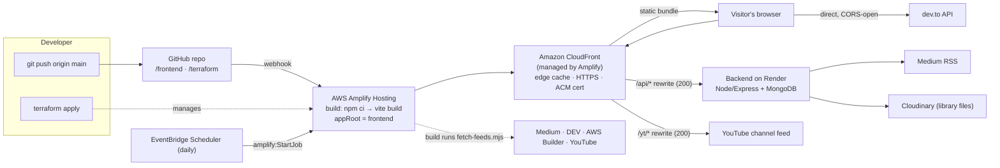

# Architecture

## Static first, live second

| Content | Source | Why |
|---|---|---|
| Profile, skills, projects, experience, education, AWS certification | Bundled at build (`frontend/src/data/*.js`) | Instant first paint, zero API calls, works if every server is down |
| Articles (Medium, DEV, AWS Builder) | Bundled snapshot written by `scripts/fetch-feeds.mjs` at every build, then refreshed live (Medium via backend, DEV direct) | Instant paint, and new posts appear within a day even with no visitor-side refresh |
| YouTube videos | Same snapshot, refreshed live through the `/yt/*` rewrite | Channel feeds have no CORS headers, so the rewrite keeps the browser same-origin |
| Library (slides, PDFs) | Backend `/api/library` | Large files and metadata live in Cloudinary/Mongo |
| Extra credentials | Backend `/api/certifications`, merged into the bundled list | Add a badge without a code change |
| Gallery photos | Bundled + `src/media/gallery`, merged with backend `/api/gallery` | Photos work offline; add more live without a redeploy |
| Business Work case studies | `src/data/business.js`, merged with backend `/api/freelance` | Same static-first pattern |
| Project / experience images | Drop files in `frontend/src/media/` (see its README) | No code change; Vite fingerprints them for CloudFront caching |
| Medium covers | Bundled in `frontend/public/blog`, then Medium CDN, then a generated cover | Covers never render blank |

`useBackend` renders the bundled data immediately and upgrades when the backend answers; each live block
shows a small badge saying whether it is the bundled snapshot or live. Render's free tier sleeps when idle
(cold start ≈ 30–60 s), so the app pings `/api/health` on load to wake it while the visitor reads the hero.

## Content that updates itself

1. `scripts/fetch-feeds.mjs` runs before `vite build` (it never fails the build; a source that errors keeps its previous snapshot).
2. **EventBridge Scheduler** starts an Amplify build once a day through the `amplify:StartJob` universal target, with a role limited to that one branch. No Lambda, webhook URL or secret.
3. In the browser, `useFeeds` asks Medium (backend), DEV and YouTube again and merges anything newer.
4. AWS Builder Center has no public per-author feed. Article links go in `awsBuilder.articleUrls` (feeds.config.js); the build reads title, summary, date and tags from the page, and also scans the site-wide RSS for posts whose author meta matches my name.

## Decisions

1. **Amplify Hosting over hand-rolled S3 + CloudFront.** Same primitives (an S3-backed origin, CloudFront, ACM),
   but with built-in CI/CD from GitHub, atomic deploys and rewrites, so the pipeline is `git push`.
2. **Same-origin `/api` via an Amplify rewrite.** The backend's CORS only allows its previous frontend's origin.
   Proxying through Amplify removes cross-origin calls entirely and needs no backend change.
3. **SPA deep links.** A rewrite rule (`</^[^.]+$|…/>` → `/index.html`) plus a post-build `dist/404.html`
   copy, so `/projects/<id>` boots the app even before the rule exists.
4. **Terraform with a module.** The Amplify app is a reusable module; the root config only supplies values.
   `import.tf.example` adopts the console-created app instead of recreating it.
5. **No secrets in the frontend.** The bundle contains only public data. The contact form composes a
   `mailto:` in the visitor's own mail client, since a static site has nowhere to POST.

## Security and cost notes

* Backend endpoints used by the site are **read-only** (`GET`); no auth tokens exist in the browser.
* Optional response headers (HSTS, nosniff, frame, referrer) via `enable_security_headers`.
* Amplify Hosting is usage-based and small for a portfolio; `budget_email` adds a monthly cost alert.
