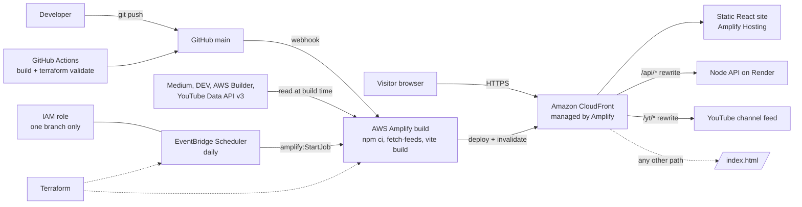

# AWS Builder Center: "Create a project" submission

> Written for: AWS Builder Center judges (AI first, then humans) and anyone reading the project page.
> How to use this file: fill the form with section A, paste section B into the **Body** box (Markdown), then
> replace every `REPLACE_…` placeholder. Section C is working material and is **not** pasted.

---

## A. Form fields

**Title** (limit 255; this is 84)
```
Find the Light: a student portfolio you read by lamplight, built and deployed on AWS Amplify
```

**Description** (limit 512; this is about 380)
```
My Cloud & DevOps portfolio starts in the dark: visitors carry a kerosene lamp (their cursor) to find my projects, skills and story. Hosted on AWS Amplify and CloudFront, defined in Terraform, with a Chaos Monkey you can fight and content that updates itself from Medium, YouTube and AWS Builder Center.
```

**Tags** (max 5)
```
aws-amplify, portfolio, terraform, react, student-portfolio-challenge
```

**GitHub or GitLab repository**
```
https://github.com/nimeshayasith/nimeshayasith
```

**Endpoint or live demo**
```
https://main.d3ag7vu427q7y9.amplifyapp.com
```

**Jupyter or SageMaker notebook**: leave empty.

**Cover image** (1200 x 675, under 2 MB, no text): generate it with the prompt in section C1.

---

## B. Article body (paste everything below into the Body box)

**Theme: Find the Light**, *a portfolio you read by lamplight.*

Most portfolios announce themselves. This one starts in the dark. You arrive, the page says **"It's dark in here,"** and your cursor turns into a kerosene lamp. Where the light falls you can read my projects, skills and story. Everywhere else stays in shadow until you carry the lamp over it, the way you would find your way through an unfamiliar room.

| | |
|---|---|
| **Live site** | https://main.d3ag7vu427q7y9.amplifyapp.com |
| **Source code** | https://github.com/nimeshayasith/nimeshayasith (`/frontend`, `/terraform`, `/docs`) |
| **Walkthrough video** | REPLACE_VIDEO_LINK |
| **Built for** | AWS Builder Center Student Portfolio Challenge (individual entry) |
| **Stack** | React 18, Vite, Tailwind, Framer Motion · AWS Amplify Hosting, CloudFront, Terraform |

### What this project is

I am Nimesha Yasith, a Computer Engineering student from Sri Lanka and an AWS Certified Solutions Architect – Associate, working toward Cloud, DevOps and SRE roles. This is my portfolio: a public website that tells my story, shows my skills, and presents 26 projects, including two I built for earlier AWS Builder weekend challenges (CloudFix Buddy and LankaResilience).

A portfolio for an infrastructure engineer should prove one thing: that I treat my own work the way I treat production. So the site is deployed from Git, defined as code, tested in a real browser, and it updates itself when I publish something new.


### The creative feature: Find the Light

**The idea.** Someone arriving at a portfolio knows nothing about me. They are in the dark. The page itself acts that out: it begins dark, and the visitor gets a lamp.

**How it works.**
- The cursor becomes a lantern with a flickering flame and a slight swing as it moves. A soft circle of light follows it; the rest of the page sits under a dark veil. In the light theme the same idea becomes a morning fog that the lantern burns away.
- The light flickers (its radius breathes like a real flame) and grows when you hover something you can click.
- On the entry screen, **"Light the lamp"** plays a synthesised match strike and a soft whoosh (Web Audio, no audio files).

**Making it work without getting in the way.** A dark page can easily become an unusable one, so these rules are part of the design:
- The navbar, every dialog and the video player sit **above** the veil, so navigation is always fully readable.
- The veil ignores the pointer, so every click lands on the page normally.
- Visitors find it three ways: the entry screen, a "move the lamp" hint on the hero, and a lamp button in the navbar. That button switches to normal "lights on" at any time, and the choice is remembered.
- **No pointer? Still lit.** Before the mouse moves, the lamp drifts by itself so the page is never just black. For keyboard users, **Tab carries the light to whatever has focus.**
- On touch screens the veil is lighter and the lantern follows your finger.
- Reduced-motion settings turn the flicker and drift off.


**More things to discover** (all real, all working):

- **Chaos Monkey you can fight.** Click *"prod looks stable. break something"* and three real components of the page you are on go down with Kubernetes-style failures (`CrashLoopBackOff`, `ImagePullBackOff`, `OOMKilled`). A status pill turns into an incident with a running **MTTR** clock. Click each broken piece to restart it, or leave it and the page self-heals after 30 seconds. It is a playable version of the self-healing and `ImagePullBackOff` fixes in my AWS and Kubernetes projects.
- **A demo reel on a laptop.** The project videos play on a laptop whose screen changes channel every few seconds, with an "Up next" list. Matching is by video title, so a new upload links itself to its project.
- **Experience as a git history.** Each role, degree and volunteer position is a commit on a branch (`main`, `education`, `community`); achievements are green `+` diff lines.
- **A résumé you read by lamplight.** My CV contains personal details, so there is no PDF to download anywhere on the site. The full résumé is readable on its own page, which cannot be selected or printed. A button emails me to request a copy.


### The three core sections

| Section | Where | What is in it |
|---|---|---|
| **About Me** | Home and `/about` | Short story, the full story, what I am looking for |
| **Tech Superpowers** | Home | 24 technologies by category: Cloud, IaC and CI/CD, Containers, Observability, Languages, Data and Web |
| **Projects and Achievements** | Home and `/projects` | 26 projects with detail pages, 8 with demo videos, the AWS certification, articles and videos |

Also: Experience, Certifications, Gallery, Business Work, Library and a read-only Résumé. It was checked on desktop and mobile (no horizontal scroll on any page).

### System architecture


```
Visitor ──HTTPS──▶ Amazon CloudFront (managed by Amplify) ──▶ static site (React build)
                        ├─ /api/*  ──▶ small Node API on Render (Medium feed, library)   [Amplify 200 rewrite]
                        ├─ /yt/*   ──▶ youtube.com channel feed                          [Amplify 200 rewrite]
                        └─ any other path ──▶ /index.html (single-page-app routing)

Developer ──git push──▶ GitHub ──▶ AWS Amplify Hosting build
                                     1. npm ci
                                     2. fetch-feeds.mjs  (Medium · dev.to · AWS Builder · YouTube Data API v3)
                                     3. vite build
                                     4. deploy + CloudFront invalidation

Terraform ───▶ Amplify app, branch, rewrites, env vars, IAM role, EventBridge Scheduler job, budget
GitHub Actions ───▶ build check and terraform fmt / validate on every push and pull request
```

**Request path.** A visitor reaches CloudFront (provisioned by Amplify Hosting), which serves the static React build over HTTPS with an AWS-managed certificate. Three Amplify rewrite rules, evaluated top to bottom, run at the edge: `/api/*` is proxied to my small backend, `/yt/*` is proxied to YouTube, and every other extension-less path returns `index.html` so deep links such as `/projects/lankaresilience` work.

**Build path.** Every push to `main` triggers an Amplify build from a monorepo spec (`appRoot: frontend`): install, sync content, build, deploy. The deploy is atomic, so visitors never see a half-built site.

**Content path.** Before each build, a script gathers my newest articles and videos into a snapshot bundled with the site (details below).

### AWS services used, and what each one does

| Service | How I use it |
|---|---|
| **AWS Amplify Hosting** | Connects to GitHub, builds on every push to `main` (monorepo `appRoot: frontend`), deploys atomically, hosts the site. Also holds the build-time environment variable for the YouTube API key. |
| **Amazon CloudFront** (managed by Amplify) | Global edge delivery, caching and HTTPS for the static site |
| **AWS Certificate Manager** (managed by Amplify) | The TLS certificate |
| **Amplify rewrites and redirects** | `/api/*` → backend, `/yt/*` → YouTube (so the browser never makes a cross-origin call and CORS does not apply), plus the single-page-app fallback |
| **AWS CLI** | I applied and verified the rewrite rules with `aws amplify update-app --custom-rules`, and read build logs with `get-job` |
| **Terraform** (AWS provider) | Describes the Amplify app, branch, rewrites, environment variables, domain association and a monthly budget alert, plus the scheduled rebuild below |
| **Amazon EventBridge Scheduler + IAM** | Defined in Terraform (`refresh.tf`): a daily job that calls the Amplify `StartJob` API through the scheduler's universal target, with a role allowed to start builds of this one branch only. No Lambda, no stored secret. |

The "Library" and "Articles via Medium" features use a small Node API on Render (outside AWS). The Amplify `/api` rewrite means that API can sit anywhere without any change to the website.

### Content that updates itself

I did not want to touch the code every time I publish. So `scripts/fetch-feeds.mjs` runs before each build and bundles:
- **Medium** posts (RSS), **DEV** posts (public API), **AWS Builder Center** articles (links I list, plus the site-wide feed filtered by author), and
- **YouTube** videos through the **official YouTube Data API v3**. The API key lives only in an Amplify environment variable: it is read by the build, never shipped to a browser and never committed to GitHub.

It **never fails the build**. If the API is down it falls back to the channel's RSS feed; if that is down too it keeps the previous list. In the browser, the site then asks Medium, DEV and YouTube again and merges anything newer, with small honest badges ("synced with YouTube", "bundled at last build"). The EventBridge job above rebuilds daily so the bundled copy stays fresh.


### Infrastructure as code and quality checks

- `terraform/` holds a reusable `amplify_hosting` module (validated in CI). The app was first created in the console, so the module is written to adopt it with `terraform import`, which keeps the live URL unchanged instead of recreating the app.
- GitHub Actions builds the frontend and runs `terraform fmt` and `terraform validate` on every push and pull request.
- I drove the site with a real headless Chrome (Playwright): entry flow, the lamp, the Chaos Monkey, the demo reel, keyboard focus, light and dark themes, and a check that every page has no horizontal overflow on a phone-sized screen.
- One type scale and one heading component are used on every page, so a heading is the same size everywhere (measured by script: h1 60 px, h2 36 px, h3 17 px on all pages).


### Security and privacy decisions

- **No secrets in the repository.** The API key and other credentials stay in Amplify or local environment files, and the repository was scanned before pushing.
- **The key is restricted** to the YouTube Data API only.
- **Least privilege:** the scheduler role can do exactly one thing, start builds of one branch.
- **Personal data:** no downloadable CV; the résumé page is read-only, and a copy is available on request.

### Challenges and what I learned

1. **A green connection that deployed nothing.** Amplify was connected to my GitHub repo, but the site returned an empty 404. The repo only held a README, and the app's default build spec published the repo *root* with an empty build command. The fix was a monorepo build spec and `AMPLIFY_MONOREPO_APP_ROOT`. *Lesson: "connected" and "built correctly" are different things; read the build spec.*
2. **CORS, and a deploy that looked right but was not.** My backend only allowed its old frontend's origin, and YouTube's feed sends no CORS headers at all. I moved both behind Amplify rewrites so the browser stays same-origin. After the first deploy, the console showed 404s on `/api` and on deep links: the rewrites were not live yet. I checked the real browser console, fixed the rules, and re-tested every route. *Lesson: test the deployed site, not only your laptop.*
3. **Free-tier cold starts.** The backend sleeps when idle (about a minute to wake). The fix was static-first rendering: the page shows bundled content instantly, then upgrades. *Lesson: design for the slow path.*
4. **A feed that fails.** YouTube's RSS feed went down for hours (a 404 even for major channels). I moved to the official API and kept RSS and the previous snapshot as fallbacks. *Lesson: do not build on an unofficial endpoint without a fallback.*
5. **A bug only the animation could cause.** The entry counter crashed the whole app once: `requestAnimationFrame` handed me a timestamp slightly *before* an earlier `performance.now()`, so progress went negative and indexed an array at `-1`. I found it by driving the page with a headless browser, and fixed it by clamping.
6. **Creative versus usable.** A dark page that hides everything is memorable and unusable. I kept the navbar and dialogs above the veil, added a visible hint and an off switch, made the lamp drift on its own when no pointer exists, and carried it to the focused element for keyboard users. *Lesson: a creative feature should earn attention without costing navigation.*
7. **Consistency is a system.** Headings had drifted from page to page. One type scale plus one heading component, then an automated check of the computed sizes on every route, fixed it.

### What I would do next

Apply the EventBridge schedule from the Terraform in my account, add CloudWatch RUM for real visitor metrics, and put a custom domain on the Amplify app.

### Try it in 60 seconds

1. Open https://main.d3ag7vu427q7y9.amplifyapp.com and click **Light the lamp**.
2. Move the mouse. Press **Tab** to see the light follow the keyboard. Click the **lamp icon** in the navbar for plain lights, and the **sun/moon** for the morning-fog version.
3. Click **break something** (bottom-left) and restart the failed pods against the clock.
4. In **Projects**, pick a demo on the laptop and press **Watch demo**.
5. In **Experience**, switch branches: `main`, `education`, `community`.
6. Open **Read résumé**.

### Links

- Live site: https://main.d3ag7vu427q7y9.amplifyapp.com
- Source: https://github.com/nimeshayasith/nimeshayasith
- Walkthrough video: REPLACE_VIDEO_LINK
- More of my writing: https://medium.com/@nimeshayasith · https://www.linkedin.com/in/nimesha-yasith/

---

## C. Working material (not part of the article)

### C1. Cover image prompt (1200 x 675, no text)

```
A single vintage brass kerosene lantern glowing warm amber in a completely dark room, seen from a slightly low angle. The light reveals a faint grid of floating cloud and server icons fading into darkness. A thin lime-green (#cefe08) rim light on the metal. Cinematic, shallow depth of field, soft film grain, deep black background, lots of empty dark space on the right. 16:9. No text, no letters, no logos, no watermark.
```

### C2. System architecture image: prompt for an AI image tool

AI image tools often garble small text. If any label comes out wrong, redraw the diagram from the Mermaid source in C3 (mermaid.live → export PNG), or in draw.io with the official AWS icon set. Check every word before uploading.

```
Create a clean, flat, professional cloud architecture diagram, 16:9, dark charcoal background (#0e0e0e), white text, lime-green (#cefe08) accent arrows, thin rounded boxes. Left to right, three horizontal lanes with these exact labels and nothing else.

LANE 1, title "Visitor request path":
Box "Visitor (browser)" -> arrow "HTTPS" -> box "Amazon CloudFront (managed by Amplify)" -> box "Static React site (Amplify Hosting)".
From the CloudFront box, two branching arrows: "/api/*  rewrite" -> box "Node API on Render"; "/yt/*  rewrite" -> box "YouTube channel feed".
Small note under CloudFront: "any other path -> /index.html".

LANE 2, title "Build and deploy path":
Box "Developer" -> arrow "git push" -> box "GitHub (main)" -> arrow "webhook" -> box "AWS Amplify Hosting build" -> arrow "deploy + invalidate" -> box "Amazon CloudFront".
Inside the Amplify build box, four small numbered steps: "1 npm ci", "2 fetch-feeds", "3 vite build", "4 deploy".

LANE 3, title "Content and infrastructure":
Box "Medium . DEV . AWS Builder . YouTube Data API v3" -> arrow "read at build time" -> box "Amplify build (fetch-feeds)".
Box "Amazon EventBridge Scheduler (daily)" -> arrow "amplify:StartJob" -> box "Amplify build". A small box "IAM role (one branch only)" attached to the scheduler.
Box "Terraform" with dotted arrows to "Amplify app", "Rewrites", "Env vars", "IAM role", "Scheduler".
Box "GitHub Actions (build + terraform validate)" pointing at "GitHub (main)".

Use official AWS-style icons where possible (Amplify, CloudFront, EventBridge, IAM). Consistent spacing, no overlapping lines, no extra text, no decorative elements.
```

### C3. System architecture, Mermaid source (reliable; paste into https://mermaid.live and export PNG)



### C4. Screenshot checklist (placeholders in the article)

Screenshots of the site are already generated in `docs/screenshots/`. The AWS console ones need you.

| # | Placeholder | What to capture | Source |
|---|---|---|---|
| 1 | `REPLACE_SCREENSHOT_URL_1` | Entry screen "It's dark in here." | `docs/screenshots/18-entry-dark.png` |
| 2 | `REPLACE_SCREENSHOT_URL_2` | Home in lamp mode, lantern over the hero | `docs/screenshots/19-lamp-hero.png` |
| 3 | `REPLACE_SCREENSHOT_URL_3` | Light theme, morning fog | `docs/screenshots/20-lamp-light-theme.png` |
| 4 | `REPLACE_SCREENSHOT_URL_4` | Chaos Monkey incident with MTTR | `docs/screenshots/06-chaos-incident.png` |
| 5 | `REPLACE_SCREENSHOT_URL_5` | Laptop demo reel | `docs/screenshots/16-demo-reel-laptop.png` |
| 6 (optional) | add near the Experience paragraph | Experience as a git history | `docs/screenshots/17-experience-git-log.png` |
| 7 (optional) | add near the résumé bullet | Read-only résumé | `docs/screenshots/21-resume-read-only.png` |
| 8 | `REPLACE_SCREENSHOT_URL_8` | **You:** Amplify console, app, build history showing the green deploy (Provision, Build, Deploy, Verify) | AWS console |
| 9 | `REPLACE_SCREENSHOT_URL_9` | **You:** Amplify, Hosting, Rewrites and redirects, showing the 3 rules | AWS console |
| 11 | `REPLACE_SCREENSHOT_URL_11` | **You:** Build log, the lines `feeds: youtube via Data API v3` and `snapshot written` | Amplify build logs |
| 12 (optional) | add under Infrastructure as code | **You:** `terraform plan` or `apply` output, if you run it | your terminal |
| 13 (optional) | add under AWS services | **You:** EventBridge Scheduler schedule, if created | AWS console |

Before capturing anything from the console: **hide or crop any secret value** (the YouTube API key), the account ID if you prefer, and your email.

### C5. Video outline (2 to 3 minutes, upload before Fri 6 Nov)

1. **0:00 to 0:15** Open the live URL. Say the theme name: "Find the Light." The page is dark; click *Light the lamp*.
2. **0:15 to 0:50** Move the lamp across the hero, About and Skills. Press Tab to show keyboard users. Toggle the lamp icon and the theme.
3. **0:50 to 1:20** Chaos Monkey: break something, restart the pods, show the MTTR clock.
4. **1:20 to 1:50** Projects: the laptop demo reel, play one demo, open a case study.
5. **1:50 to 2:20** Experience as a git history; the read-only résumé.
6. **2:20 to 3:00** AWS side: Amplify build history, rewrites, environment variable (hide the value), Terraform folder, the build log line for the Data API. End on the live URL and GitHub link.

### C6. How this meets the judging rubric

| Criterion (weight) | Where the article answers it |
|---|---|
| **Creativity and memorability (30%)** | "The creative feature: Find the Light", the extras (Chaos Monkey, laptop reel, git-history experience), the theme name, the entry screen |
| **Working AWS implementation (25%)** | Live link and 60-second tour, architecture, services table, Amplify and CloudFront screenshots, rewrite rules, IaC |
| **Communication quality (25%)** | Plain-language intro, diagram plus text, numbered challenges with lessons, screenshots and video |
| **Portfolio completeness and usability (20%)** | Three core sections table, mobile checks, keyboard / touch / reduced-motion handling, off switch for the lamp |

### C7. Before you publish

- [ ] Replace every `REPLACE_…` (6 screenshot URLs, the architecture image, 2 video links).
- [ ] If you do **not** apply the Terraform, change the "Amazon EventBridge Scheduler + IAM" row and the sentence "The EventBridge job above rebuilds daily" so they say it is *defined in Terraform and not yet applied*, or delete them. Do not claim what you have not deployed.
- [ ] Make sure the live URL works on your phone and on a second network.
- [ ] Delete section C before pasting. Only section B goes in the Body box.
